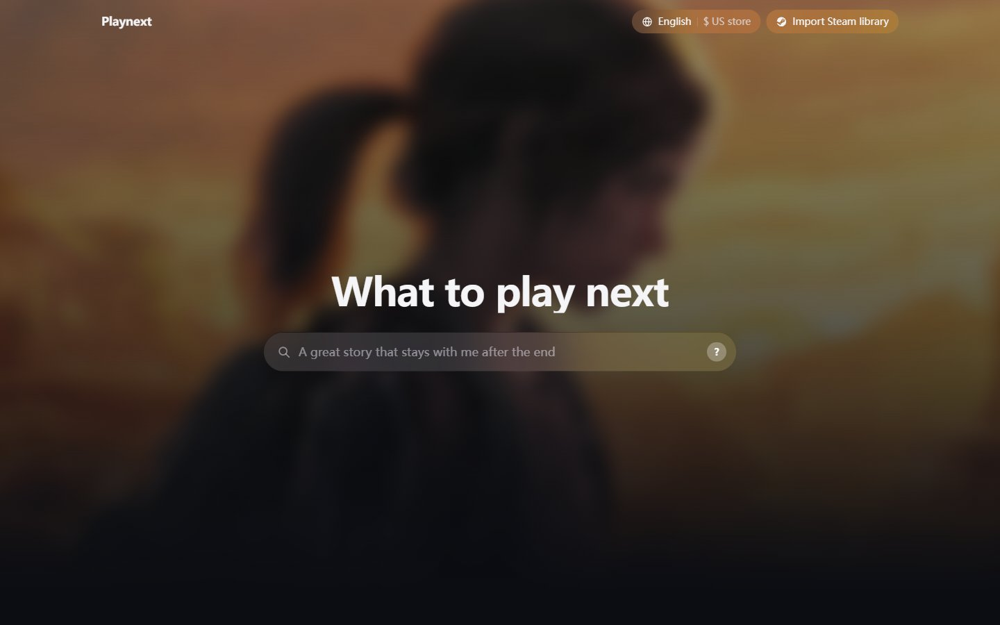
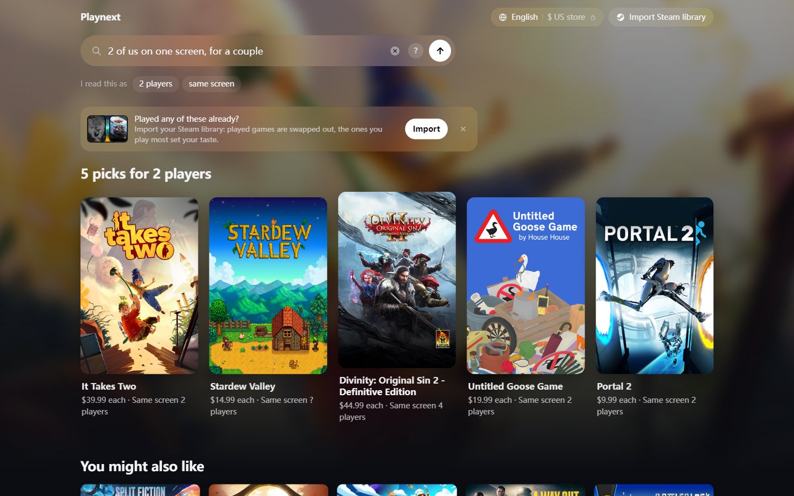
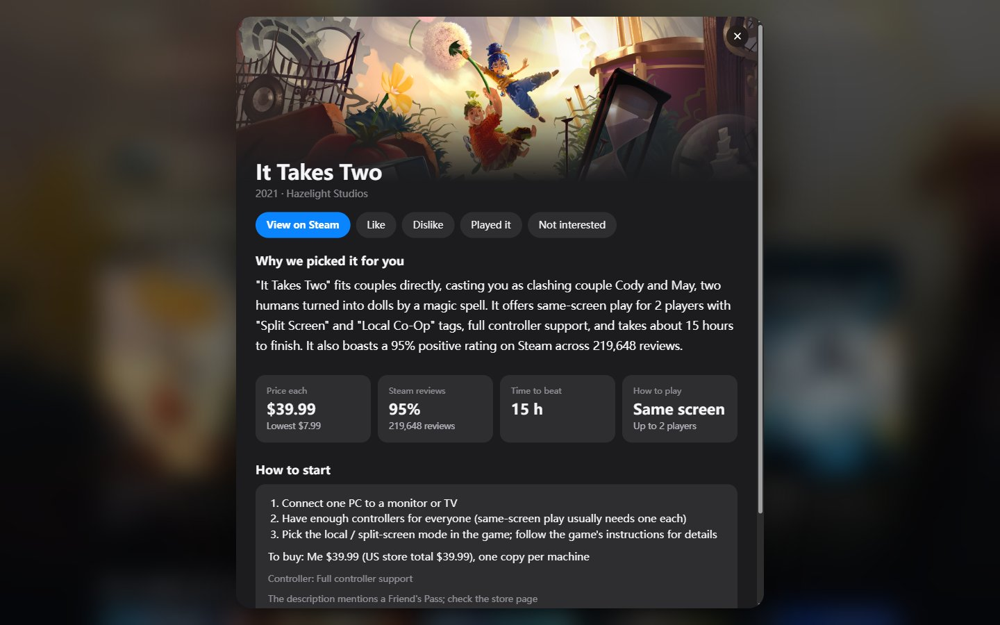

<div align="center">

# Playnext

**Tell it what you feel like playing. Get five Steam games that fit, and why.**

[**Try it → playnext.peteroooooooo.com**](https://playnext.peteroooooooo.com)

English · 中文 · CN and US Steam store



</div>

## What it does

Playnext is a Steam game recommender you talk to in plain words. You don't have to fill in a form or know a single tag
name. Write something like *"2 of us on one screen, for a couple"* or *"像《哈迪斯》那样的，但别那么难"*. It works out the
conditions, rules out every game that breaks them, and picks five from 7,304 well-reviewed Steam games.

- **Your own words, Chinese or English.** Taste ("relaxing, not too grindy"), reference games ("like Terraria"), budget,
  party size and how you play can all go in one sentence.
- **Playing together.** It knows the difference between same-screen and online co-op, checks player limits, and works out
  who still needs to buy a copy and what that costs.
- **Your Steam library, if you want.** Sign in with Steam or paste a profile link. Games you've already played are
  swapped out, and the ones you've put the most hours into set your taste. The Steam ID is never stored.
- **Real prices.** CN or US store, checked live for the shortlisted games, with the all-time low next to the current price.
- **Every pick explained.** Each card says why it fits your request, with the Steam rating, time to beat, and how to set
  up the game for your group. The reasons are checked against the store data before they are shown.
- **Keep the conversation going.** Add *"cheaper"* or *"no horror"* and the list updates. If nothing fits, it tells you
  which condition to loosen and how many games that would bring back.

<table>
  <tr>
    <td></td>
    <td></td>
  </tr>
  <tr>
    <td align="center">Five picks for <i>"2 of us on one screen, for a couple"</i></td>
    <td align="center">Why this one, and how to start</td>
  </tr>
</table>

### Things to ask

| On my own | With friends | From a game I like | On a budget |
|---|---|---|---|
| Something relaxing and cozy, farming or management, not too grindy | 4 of us, each at home, want a silly relaxed co-op game, under $20 each | Like Hades, but not as hard | A good game under $10 that's on sale now |
| Hard but fair, I want to try again every time I die | 4 of us online, fighting monsters that feels great | Tired of Vampire Survivors, looking for something similar | The cheapest co-op game possible, 3 players |

## How it works

Every request goes through the same five steps. The LLM reads the request, judges fit against the store
descriptions and writes the card text. Which games are allowed at all is decided by data and rules, so a game that
breaks a stated condition can't slip in.

1. **Understand.** An LLM turns the request into a structured spec: people, where each person sits, budget, store,
   reference games and taste. Game names are matched to Steam AppIDs through an alias table that includes common
   Chinese nicknames.
2. **Rule out.** Hard checks on multiplayer mode, player limits, price, region and platform. Each check returns
   pass, fail or unknown, so missing data never counts as a pass.
3. **Score.** Tag similarity and co-like are multiplied, so a game has to do well on both. Co-like is "players who liked X also liked Y",
   learned with [EASE](https://arxiv.org/abs/1905.03375) from 161 million Steam reviews. Library games are weighted
   by how much more you played them than other players did. Groups are scored on the average and the least happy member.
4. **Rerank.** When the request has taste in words or reference games, an LLM reads the store descriptions of the top
   candidates and scores how well each one fits. Its score is blended 70 / 30 with step 3.
5. **Pick and explain.** Same-series duplicates are folded, a rating floor applies, and the final five are kept diverse.
   Prices are rechecked live and the cards are written.

The full walk-through, with every score shown on real examples, is in
[docs/pipeline_architecture.html](docs/pipeline_architecture.html) (download it and open it in a browser). The design
and every decision behind it are in [docs/Core_Technical_Skeleton.md](docs/Core_Technical_Skeleton.md).

## Does it work?

All numbers below are measured on reviewers held out from training.

| Test | Result |
|---|---|
| Recommend from a player's library (200 players, Recall@20) | **0.178** for Playnext, 0.137 for asking an LLM directly, 0.122 for the most popular games |
| Co-like method (50,000 players, Recall@20) | EASE 0.222, cosine similarity 0.168, most popular 0.149 |
| Asked for two mechanics, e.g. "co-op + roguelike" (60 combinations, top 5) | Both are core to the game in 100% of picks, against 53.7% when a tag only has to appear |

The method, confidence intervals and limits are in section 7 of the design document.

## Privacy

- The LLM only sees what you typed and the store descriptions of the games. It never sees your Steam ID or library.
- Steam IDs are used for one library request and not saved.
- Reviewer IDs in the review data are replaced with a keyed hash as soon as they are read.
- Card feedback (like / played / not interested) is kept only for signed-in accounts, under a keyed hash.


## Data

Playnext recommends from **7,304 Steam games**: every game with at least 1,000 reviews, minus software, demos and
duplicate editions.

| Source | What it gives us |
|---|---|
| Steam store | Tags, descriptions in English and Chinese, multiplayer modes, ratings, CN and US prices (refreshed daily) |
| Steam reviews | 161 million reviews from 52 million players (2010 to 2026), the basis of "players who liked X also liked Y" and of the offline tests. Kaggle [steam-reviews-100m](https://www.kaggle.com/datasets/sergiodelcarpio/steam-reviews-100m) (MIT) plus our own crawl of newer and missing reviews |
| IGDB | Player counts, game series, time to beat |
| IsThereAnyDeal | All-time low prices |
| Steam Web API | Your library, only when you import it |

More detail per source: [docs/Data_Sources.md](docs/Data_Sources.md).

## For developers

```
uv sync --no-group models                              # Python 3.12, locked dependencies
npm --prefix web install && npm --prefix web run build
uv run uvicorn --app-dir src playnext.api:app --host 127.0.0.1 --port 8000
```

- `.env` holds the keys for the Steam Web API, IGDB (Twitch), IsThereAnyDeal and an OpenAI-compatible LLM endpoint.
  PostgreSQL is optional (`docker compose up -d`).
- The data tables are not in the repo. The `fetch_*` and `build_*` scripts in `scripts/` build them.
- Every weight and threshold is in `src/playnext/config.py`. Tests: `uv run pytest` and `npm --prefix web test`.
- The app has no login of its own. Run it behind a reverse proxy that adds HTTPS and a rate limit (`scripts/deploy.ps1`).

Built with Python 3.12, FastAPI, NumPy / SciPy / pandas, PostgreSQL 16, React 18, TypeScript and Vite.

## Credits

Price data courtesy of IsThereAnyDeal. IGDB data is used for non-commercial purposes. Not affiliated with Valve or
Steam.

## Team

An NUS-ISS group project ("Backlog Breaker").

- [@Peteroooooooo](https://github.com/Peteroooooooo)
- CAO HEQIAO ([@Mikebourne7](https://github.com/Mikebourne7))
- [@xskyyi0916-pixel](https://github.com/xskyyi0916-pixel)
